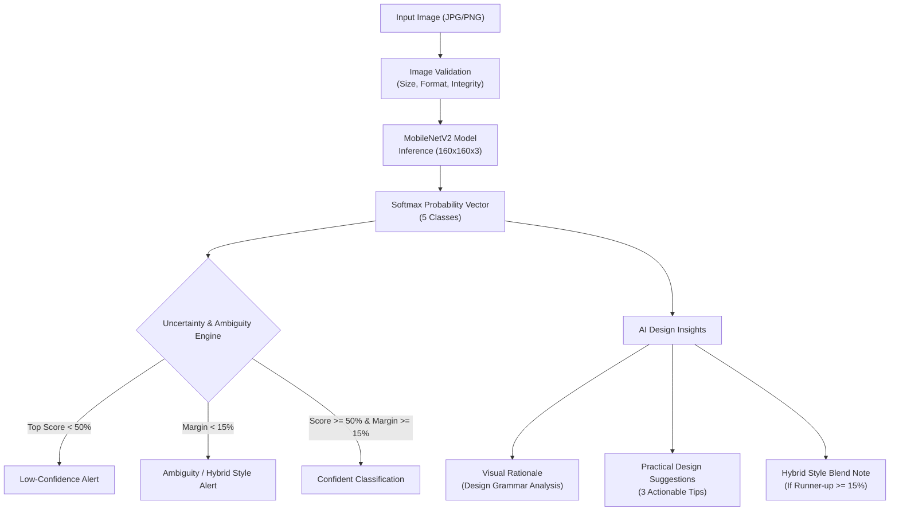

# SWYNEX Task 3: Intelligent Feature — AI Design Insight Assistant

A comprehensive Streamlit application that combines a deep learning graphic design classifier with an **AI Design Insight Assistant**. The app classifies posters and graphic artwork into 5 design styles, detects prediction ambiguity, provides rule-based composition rationale, and delivers actionable design refinement suggestions.

**Internship:** SWYNEX Technologies  
**Task Track:** Task 3 — Intelligent Feature  
**Repository Name:** `SWYNEX-Intelligent-Feature`  
**Base Model:** MobileNetV2 Transfer Learning (Keras 3 / TensorFlow 2.16+)

---

## 1. Project Objective

In Task 1 and Task 2, a transfer-learning convolutional neural network was trained and integrated into a prototype web application. While traditional computer vision models output static class probabilities, designers need actionable context:
* *Why did the model classify this poster as "Cinematic" or "Minimalist"?*
* *Is the model confident, or is the design a hybrid fusion of two styles?*
* *How can the composition, color grading, or typography be refined to strengthen the aesthetic?*

**Task 3 Objective:** Implement an **AI Design Insight Assistant** that bridges the gap between raw machine learning probability outputs and practical graphic design workflow through transparent, deterministic heuristic analysis and robust edge-case validation.

---

## 2. The Intelligent Feature: AI Design Insight Assistant

The **AI Design Insight Assistant** operates directly on top of the deep learning model's output distribution:



### Key Capabilities:
1. **Style Classification:** Predicts one of 5 design styles: `Cinematic`, `Minimalist`, `Typography`, `Sports`, and `Vintage`.
2. **Ambiguity & Margin Analysis:** Compares the 1st place and 2nd place predictions. If the margin is less than $15\%$, the app flags the prediction as ambiguous and explains which two styles are competing.
3. **Low-Confidence Detection:** If the top score is below $50\%$, the app surfaces an alert advising human manual review.
4. **Visual Rationale:** Explains the design grammar, lighting, typography, and compositional elements associated with the predicted category.
5. **Practical Design Suggestions:** Provides 3 actionable, professional refinement recommendations tailored to the predicted style.
6. **Hybrid Blend Analysis:** When the runner-up style has significant weight ($\ge 15\%$), provides guidance on how to either emphasize a single style or harmoniously execute an intentional hybrid.
7. **Transparent AI:** Explicitly clarifies that rules are deterministic heuristics derived from design principles, avoiding misleading claims about external LLM generation.

---

## 3. Supported Styles & Design Grammar

| Style | Visual Grammar & Classifier Triggers | Key Refinement Focus |
|---|---|---|
| **Cinematic** | Atmospheric lighting, shallow depth of field, high contrast, mood-driven color palettes (teal & orange), and narrative focal points. | Three-point lighting, atmospheric depth, wide-tracked title typography. |
| **Minimalist** | Generous negative space (35–50%+), restrained color schemes (monochrome/duotone), stripped-down geometric focal elements. | Preserving breathing room, extreme scale contrast, strict palette discipline. |
| **Typography** | Letterforms and layout grids treated as the primary visual hero rather than captions; strong figure-ground contrast. | Optical kerning, golden-ratio font scale hierarchy, baseline grid alignment. |
| **Sports** | High-energy diagonal vectors (15–30°), dynamic action silhouettes, saturated high-contrast colors, athletic momentum. | Directional motion streaks, vibrant accent pairings, heavy condensed sans-serifs. |
| **Vintage** | Warm analog tones (sepia, ochre), subtle halftone/paper textures, distressed borders, mid-century badge ornamentation. | Analog grain overlays, historical slab-serifs/scripts, archival muted color palettes. |

---

## 4. Project Directory Structure

```text
SWYNEX-Intelligent-Feature/
├── .gitignore                          # Ignores venv, caches, test artifacts, and secrets
├── app.py                              # Streamlit web application with UI layout and error handling
├── insights.py                         # Heuristic rule engine for design insights and uncertainty analysis
├── README.md                           # Comprehensive documentation and setup guide
├── requirements.txt                    # Project dependencies (Streamlit, TensorFlow, NumPy, Pillow, Pytest)
│
├── model/
│   └── graphic_design_classifier.keras # Trained Keras 3 model (~9.7 MB)
│
├── examples/
│   ├── cinematic_01.jpg                # Valid sample: Cinematic
│   ├── minimalist_02.jpg               # Valid sample: Minimalist (Ambiguous test case)
│   ├── sports_01.jpg                   # Valid sample: Sports
│   ├── typography_01.jpg               # Valid sample: Typography
│   ├── vintage_01.jpg                  # Valid sample: Vintage
│   └── example_outputs.md              # Documented live test outputs
│
├── evaluation/
│   ├── evaluate_model.py               # Automated evaluation and edge-case test runner
│   ├── evaluation_examples.md          # Comprehensive evaluation documentation and test plan
│   └── evaluation_report.md            # Live generated evaluation report with timestamps
│
├── tests/
│   ├── test_insights.py                # Automated tests for rule engine and uncertainty logic
│   ├── test_preprocessing.py           # Automated tests for image tensor pipeline
│   └── test_error_handling.py          # Automated tests for corrupted/invalid file handling
│
└── screenshots/
    └── README.md                       # Instructions for capturing submission screenshots
```

---

## 5. Live Evaluation & Verified Results

All 5 sample images were evaluated using the automated evaluation script ([`evaluation/evaluate_model.py`](evaluation/evaluate_model.py)):

| Sample File | Predicted Style | Top Confidence | Runner-up Style | Margin | Uncertainty Status |
|---|---|---|---|---|---|
| `cinematic_01.jpg` | **Cinematic** | 87.5% | Sports (6.8%) | 80.6% | ✅ Confident |
| `minimalist_02.jpg` | **Minimalist** | 31.9% | Typography (22.0%) | 9.9% | ⚠️ Uncertain (Low score + Narrow margin) |
| `sports_01.jpg` | **Sports** | 91.3% | Cinematic (5.1%) | 86.2% | ✅ Confident |
| `typography_01.jpg` | **Typography** | 95.7% | Sports (1.8%) | 93.9% | ✅ Confident |
| `vintage_01.jpg` | **Vintage** | 97.8% | Sports (0.8%) | 97.0% | ✅ Confident |

### Edge-Case Handling Verification

| Test Case | Condition Tested | Result | Application Message |
|---|---|---|---|
| Corrupted File | Non-image binary stream | ✅ Handled | *"This file is not a valid or readable JPG/PNG image."* |
| Undersized Image | 16 × 16 px image | ✅ Handled | *"The image is too small (16 x 16 px). Minimum required size is 32 x 32 px."* |
| Oversized File | 12 MB file | ✅ Handled | *"The file is 12.0 MB. Please upload an image under 10 MB."* |
| Non-finite Output | `[0.1, NaN, 0.4, 0.2, 0.3]` | ✅ Handled | Caught with `ValueError` and user-friendly alert. |
| Missing Model File | Path non-existent | ✅ Handled | Halts with `st.stop()` and informs user how to place the model file. |

---

## 6. Installation & How to Run

### Prerequisites
* Windows 10/11, macOS, or Linux.
* **Python 3.10–3.12** (TensorFlow requires Python $\le 3.12$; Python 3.15 is not supported).

### Setup Steps (Windows PowerShell)

```powershell
# 1. Clone or open the project folder
cd D:\SWYNEX-Model-or-API-Integration

# 2. Create a clean virtual environment using Python 3.12
py -3.12 -m venv venv

# 3. Activate the virtual environment
.\venv\Scripts\Activate.ps1

# 4. Upgrade pip and install dependencies
python -m pip install --upgrade pip
pip install -r requirements.txt

# 5. Run the automated test suite
pytest tests

# 6. Run the model evaluation script
python evaluation/evaluate_model.py

# 7. Launch the Streamlit application
streamlit run app.py
```

Open your browser at **[http://localhost:8501](http://localhost:8501)**.

> [!NOTE]
> If PowerShell blocks script execution, run:
> ```powershell
> Set-ExecutionPolicy -Scope CurrentUser -ExecutionPolicy RemoteSigned
> ```

---

## 7. Model Architecture & Pipeline Facts

| Component | Specification | Notes |
|---|---|---|
| **Base Model** | `MobileNetV2` | Pre-trained on ImageNet with weights frozen. |
| **Top Layers** | `GlobalAveragePooling2D` &rarr; `Dropout(0.2)` &rarr; `Dense(5, softmax)` | 5 class output probabilities. |
| **Input Shape** | `(160, 160, 3)` | Nearest-neighbor resize from RGB image. |
| **Normalization** | Embedded inside `.keras` model | Scales raw `[0, 255]` inputs to `[-1, 1]` via `x / 127.5 - 1`. The app does not divide by 255. |
| **Model Size** | 9,698,107 bytes (~9.7 MB) | Tracked directly in Git (well below GitHub's 100 MB limit). |

---

## 8. Honest Limitations & Ethical AI Considerations

1. **Dataset Size:** The model was trained in Task 1 on **20 AI-generated sample images** (4 per style). This small sample set is intended for academic and prototyping demonstration only.
2. **Generalization:** No independent generalization metric is claimed for unseen commercial designs.
3. **Softmax Interpretation:** Softmax scores reflect internal logits distribution across 5 closed classes. High scores do not equal calibrated real-world probabilities.
4. **Human-in-the-Loop:** The AI Design Insight Assistant is intended as a creative companion to inspire and flag potential ambiguities, not replace professional human design judgment.

---

## 9. GitHub Submission Instructions

To push this project to a new repository named `SWYNEX-Intelligent-Feature`:

1. Go to [https://github.com/new](https://github.com/new) and create a new repository:
   - Repository name: `SWYNEX-Intelligent-Feature`
   - Description: `SWYNEX Internship Task 3: Graphic Design Classifier with AI Design Insight Assistant`
   - Visibility: **Public**
   - **Do NOT initialize with README, .gitignore, or license** (all are already included here).
2. Open PowerShell in `D:\SWYNEX-Model-or-API-Integration`:
   ```powershell
   # Initialize git
   git init

   # Stage all project files (venv and test caches are ignored automatically)
   git add .

   # Commit
   git commit -m "Complete SWYNEX Task 3: Intelligent Feature (AI Design Insight Assistant)"

   # Set branch to main
   git branch -M main

   # Add remote
   git remote add origin https://github.com/maniram02112006/SWYNEX-Intelligent-Feature.git

   # Push
   git push -u origin main
   ```

---

## 10. Security & Privacy

* **100% Local Processing:** Model inference and heuristic insight generation run entirely on your local CPU.
* **No External APIs:** No images or personal data are transmitted over the network.
* **No Stored Credentials:** No API keys, passwords, or tokens are required or used.
